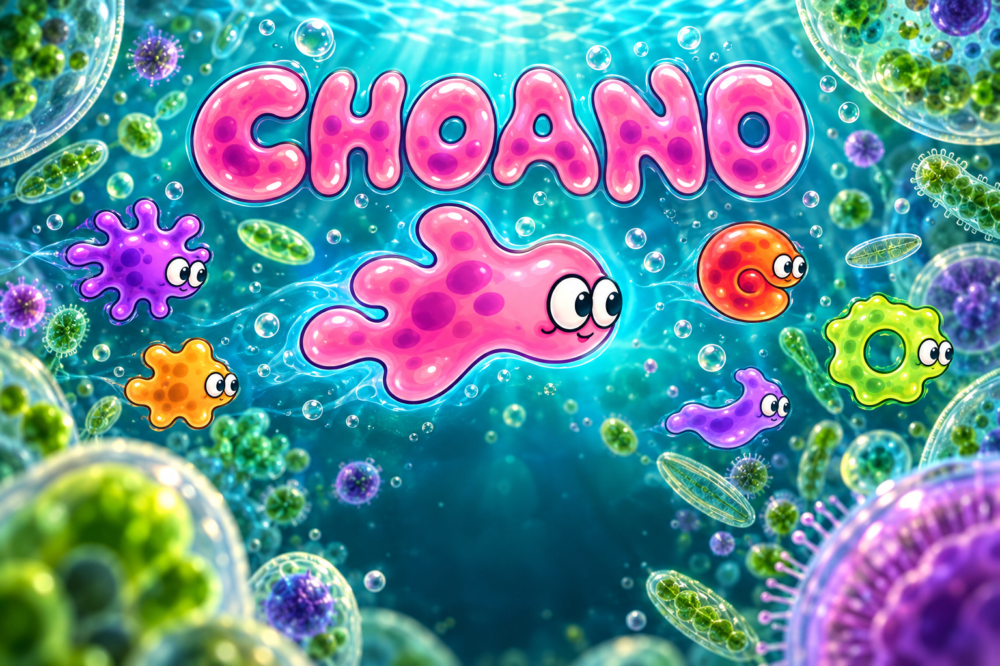

# Choano

Swim, eat and grow in a microscopic world. Eat equal or smaller amoebas,
avoid larger ones, and stay inside the petri dish. Spawn warnings give you
time to move; cumulative growth earns extra lives. An illustrated title screen opens the game, with native in-app navigation.

[Play in your browser](https://choano.waozi.xyz/)
· [Source](https://github.com/waozixyz/choano)



Six quiet event chimes replace the old beat and spawn noises. There is no
loading message or browser footer; forming bubbles stay beneath the player.

Native and browser editions share the same Ziran game rules and Kryon
widgets. All artwork and audio are replacements made for Choano. Original
Moeboid assets and binaries are excluded; see [asset provenance](ASSETS.md).

## Controls

Desktop and browser: hold arrow keys or WASD to swim. Enter after game over
or R starts a fresh run. Choose Swipe or Direction pad on first Play. Change controls or sound from
the in-app Settings or Pause screen. Profile pauses play and opens the shared Entity account UI;
Back returns to the same run. Signing in is optional. Earned growth stages
follow that account; the current run stays on this device and is not restored
after closing the game.

The same title, pause, settings and movement-control flow runs in compatible
game libraries. Back returns through the current screen before leaving the game.

## Build and local tests

Install Ziran and the SDL2, Cairo, FreeType, Fontconfig, Pango, GTK and X11
development libraries. Emscripten is needed for the browser edition. Package
sources and the compiler are pinned in `ziran.lock`; local overrides belong
in ignored `ziran.local.toml`.

```sh
ziran fetch --locked
make test
make all
./build/Choano-native
make web
python3 -m http.server --directory build/web
```

`EMCC` may point to Emscripten's `emcc`; otherwise the browser builder uses
`~/emsdk/upstream/emscripten/emcc` or `emcc` from PATH. `make all` produces
`build/Choano-native` and `build/choano.zx`. Window tests use only a fresh
private Xvfb display; browser tests use a disposable headless Chromium profile.

## Independent game package

`apps.json` and `catalog.json` declare Choano's stable identity
`xyz.waozi.choano`, portable entry and cover artwork. The portable edition uses
`apps/node_app`, the generic `kryonlabs/game2d` navigation/control modules,
and Entity's `game_progress` schema through bounded host
services. Hosts own account keys, record IDs, storage and synchronization.
Arcade is a consumer/catalog of this package and is not a Choano dependency.
This repository does not change Arcade's catalog or publish a signed node package.

## Website delivery

The Choano GitHub Actions workflow tests the native and portable game, builds
the browser edition with the locked shared Entity provider, and exercises
swimming, Profile/Back, restart and reload in headless Chromium. Successful
master builds deploy to the Cloudflare Pages project `choano` and connect
`choano.waozi.xyz`. Repository secrets `CLOUDFLARE_API_TOKEN` and
`CLOUDFLARE_ACCOUNT_ID` configure deployment; credentials are never committed.

This initial publication has no numbered binary release. Work remains under
`Unreleased` until a versioned release is requested.
